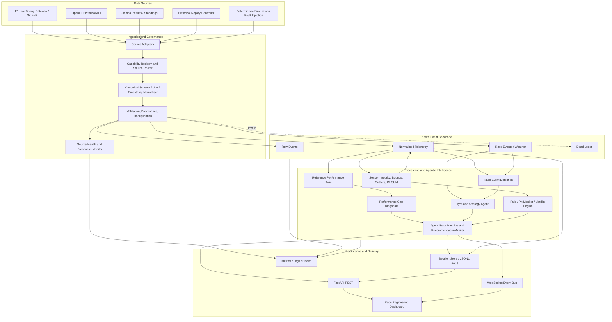

# CALIBRE — Planned System Architecture

**Document status:** Target architecture to reconcile with the existing implementation.

## 1. Architecture goals

- One canonical event pipeline for live, replay and simulation.
- Kafka as the actual streaming backbone.
- Source adapters separated from processing agents.
- Evidence-aware agent outputs and auditable decisions.
- A replay mode that is suitable for live demonstrations without an active race.
- Clear separation between measured facts, derived features, estimates and synthetic scenarios.
- End-to-end observability so failures are visible in the UI.

## 2. Logical architecture

The diagram describes intended logical flow. The implementation must verify which modules already exist and adjust the diagram to match the final deployed topology.

## 3. Operating modes

### LIVE
Live connectors publish observations. Source outages mark the system degraded. No silent switch to another mode.

### HISTORICAL_REPLAY
A replay controller loads actual recorded data, orders events by source event time and publishes them at a controlled pace. Replay uses the same downstream Kafka topics and consumers as live mode. The original source time and replay clock are stored separately.

### SIMULATION
A deterministic generator publishes explicitly synthetic data and scenario overlays. Simulation is used for repeatable fault injection and scenarios not present in historical sessions.

Mode is a first-class attribute in events, API responses, UI and logs.

## 4. Source routing and data trust

Do not use one global source priority for every field. Route by event type and capability.

- Live timing source: timing, sectors, positions, race-control and any telemetry fields it actually supplies.
- OpenF1: historical timing/telemetry and environmental data where available.
- Jolpica: results, standings and historical reference.
- Replay: recorded event stream with original timestamps.
- Mock: synthetic scenarios only.

A direct SignalR connector and a gateway consuming the same upstream feed are alternate paths, not independent evidence sources. Avoid counting their duplicate messages as independent corroboration.

## 5. Canonical event processing

Pipeline:
1. Receive raw payload.
2. Assign source and mode metadata.
3. Preserve original payload or durable reference.
4. Parse and normalise timestamps/units.
5. Validate schema and plausible ranges.
6. Deduplicate using a stable source-aware identity.
7. Publish raw/normalised events and quarantine invalid events.
8. Update source and channel freshness.
9. Deliver to independent Kafka consumers.

All timestamps should distinguish source event time, ingestion time and replay time where applicable.

## 6. Kafka design

### Topic responsibilities
- `calibre.raw.telemetry`: raw telemetry/source payloads.
- `calibre.normalized.telemetry`: canonical validated observations.
- `calibre.race.events`: flags, safety car, penalties, pit and session events.
- `calibre.weather`: observed weather records.
- `calibre.sensor.integrity`: integrity findings.
- `calibre.reference.performance`: reference model updates.
- `calibre.performance.diagnostics`: diagnosed gaps.
- `calibre.strategy.predictions`: scenario estimates and recommendations from strategy models.
- `calibre.agent.decisions`: orchestrated decision records.
- `calibre.alerts`: prioritised alert lifecycle events.
- `calibre.deadletter`: invalid/unprocessable events with error context.

Actual topic count can be reduced if existing topology has equivalent clear boundaries. Do not create unused topics simply to match a diagram.

### Partitioning and delivery
Choose keys that preserve required order, such as session plus driver for per-driver telemetry. Document partition-level ordering limitations. Use idempotent producers where supported, retry policy, consumer-group isolation, dead-letter routing and replay-safe idempotency.

Do not claim end-to-end exactly-once processing unless transactional semantics and external side effects are genuinely coordinated. Prefer documented at-least-once delivery plus idempotent processing if that matches the implementation.

### Local deployment
Use a supported Kafka KRaft single-node development configuration in Docker Compose where appropriate. Provide health checks, topic setup and a no-Docker/offline test mode only if the repository genuinely supports it. A mock in-process queue is not equivalent to Kafka.

## 7. Agentic processing architecture

### Sensor Integrity Agent
Detects anomalies and emits evidence-rich quality events. It does not directly overwrite raw observations.

### Reference Performance Agent
Builds a comparable reference envelope using historical laps and available signals. It must include baseline selection, comparability conditions, model version and uncertainty.

### Performance Diagnosis Agent
Maps supported deviations to sectors/segments and estimates time loss. It emits explanations only to the level justified by source resolution.

### Race Event Agent
Consumes observed race-control events and separately produces forecast risks. Facts and forecasts have different event types.

### Tyre and Strategy Agent
Evaluates stint, degradation, pit windows and tactical alternatives from available data and explicit assumptions.

### Verdict Engine / Pit Monitor
Applies auditable configured rules and returns BREACH, CLEAR or DEFER. It is not an official FIA adjudication system.

### Agent State Machine / Recommendation Arbiter
Coordinates update cadence, input quality, conflicts, priority, expiry and withdrawal of recommendations. LLM-based wording may explain validated results but cannot fabricate evidence or replace deterministic rule evaluation.

## 8. Persistence and API

Persist enough information to reproduce and audit a session:
- session metadata;
- raw/normalised events or references;
- model/rule versions;
- integrity findings;
- reference comparisons;
- strategy alternatives;
- verdicts;
- recommendations and lifecycle;
- source health and failures;
- replay configuration and scenario seed.

FastAPI exposes query/control endpoints. WebSocket streams state changes. Reconnecting clients obtain a snapshot and then resume event consumption. JSONL is suitable for local audit/export but does not replace Kafka.

## 9. Observability architecture

Track:
- source connection and per-channel freshness;
- events received, normalised, rejected and published;
- Kafka producer errors, consumer lag and processing latency;
- agent invocation count, duration, errors and skipped/deferred reasons;
- WebSocket client status and delivery errors;
- replay clock, speed, event index and duplicate suppression;
- API latency and error rates.

Every “healthy” status must derive from a real check. Unknown metrics must remain unknown rather than displaying zero.

## 10. Failure handling

- Source failure: mark degraded, retry with bounded exponential backoff and jitter.
- Invalid event: quarantine with reason; preserve raw evidence where configured.
- Kafka unavailable: fail readiness or mark degraded; do not claim streaming works.
- Consumer failure: expose lag, restart/recover state and avoid duplicate agent actions.
- Missing telemetry: mark field unavailable; agents defer or reduce confidence.
- Replay seek/restart: rebuild state from a defined checkpoint or replay prefix; suppress duplicate side effects.
- Conflicting recommendations: arbiter resolves by evidence, priority and expiry.
- UI/API disconnection: show stale state and provide resynchronisation.

## 11. Security and operational boundaries

- Credentials belong in environment variables/secrets, never in source control.
- Development-only fault injection must be disabled or protected in production.
- Mutating replay controls must prevent conflicting playback controllers.
- Avoid unrestricted exposure of raw payloads or environment configuration.
- Respect provider access conditions and document unofficial/undocumented dependencies.

## 12. Architecture decision gates

Before marking architecture implemented, verify:
1. A replay event can be traced from source file/API through Kafka to a consumer and UI.
2. Kafka topic and consumer metrics reflect real broker state.
3. An injected sensor fault creates a finding from actual processed input.
4. A reference comparison uses actual replay data and a documented baseline.
5. A recommendation links to evidence and a model/rule version.
6. API/WebSocket outputs match the same session and mode.
7. Failure injection produces visible degraded status.
8. Replaying the same inputs reproduces materially equivalent results.

## 13. Implementation priority

1. Repository and UI audit; identify placeholders and dead controls.
2. Prove one vertical slice: historical source → normaliser → Kafka → consumer → API/WebSocket → UI.
3. Instrument source, Kafka and consumer health.
4. Verify sensor-integrity end-to-end with injected faults.
5. Verify reference-performance comparison and evidence-linked diagnosis.
6. Verify strategy response to an injected race event.
7. Add UI E2E and failure-state coverage.
8. Expand sources and optimisations only after the vertical slice is proven.
