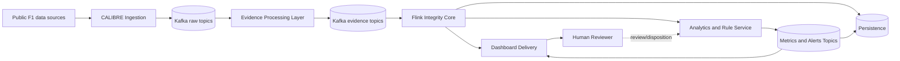

# CALIBRE — System Requirements Specification (SRS)

| Document control | Value |
|---|---|
| Document ID | CAL-DOC-003 |
| Version | 1.0-draft |
| Date | 1 November 2026 |
| Status | Platform-level SRS baseline |
| Parents | CAL-DOC-001 and CAL-DOC-002 |

## 1. Introduction

### 1.1 Purpose

This SRS specifies the intended system context, major components, external interfaces, data model, quality requirements and operational constraints for CALIBRE Phase 1. It defines platform behaviour without prescribing the final internal design of specialist evidence processors.

### 1.2 Product scope

CALIBRE is a read-only motorsport evidence acquisition, integrity-assurance and analytics platform. It ingests free/public live and historical F1 data, preserves raw evidence, transforms source records into versioned evidence events, correlates them using Apache Flink, and routes results to persistence, dashboard delivery and downstream analytics.

### 1.3 Intended readers

System architects, ingestion developers, evidence-processor developers, Kafka/Flink developers, analytics developers, dashboard developers, testers and operators.

## 2. Overall system description

### 2.1 Product perspective

CALIBRE is an independent layer surrounding external data sources. It does not control or replace the source systems. The platform is organised into these logical subsystems:

1. **Source adapters and ingestion:** connect to permitted sources, capture and publish raw envelopes.
2. **Kafka raw evidence fabric:** buffers and fans out source events.
3. **Evidence processing layer:** provider parsing, validation, normalisation and domain-specific evidence generation. Internal processor boundaries are pluggable.
4. **Kafka evidence fabric:** carries versioned evidence events to Flink.
5. **Flink integrity core:** event-time processing, dependency-aware correlation, evidence bundling and scoped integrity assessment.
6. **Persistence output:** stores raw references, evidence, bundles, assessments and history.
7. **Dashboard output:** delivers continuous operational data and state.
8. **Analytics/rule service:** derives metrics, evaluates rules and issues human-review alerts.

### 2.2 User classes

| User class | Main actions |
|---|---|
| Operator | Select source/replay, monitor pipeline health, inspect current session and alerts. |
| Investigator/reviewer | Inspect alert context, source lineage, evidence and revisions. |
| Developer | Implement adapters, processors, core logic, analytics and output consumers. |
| Maintainer | Manage deployment, Kafka/Flink health, retention, recovery and configuration. |

### 2.3 Operating environment

- Development and test environment on a general-purpose workstation/server.
- Windows-based local development is currently used; deployment environment is not fixed by this SRS.
- Python is the initial source-adapter and evidence-processing implementation language.
- Apache Kafka is the target event transport.
- Apache Flink is the target stateful stream-processing core.
- Persistent database, dashboard framework, orchestration and production deployment platform remain technology decisions to be confirmed.

### 2.4 Source and cost constraints

The approved free Phase 1 source configuration is:

| Source | Purpose | Authentication/cost condition | Limitation |
|---|---|---|---|
| Pitwall / F1 SignalR | Live permitted public topics | No F1 TV token for configured free topics | Does not include F1-TV-gated `CarData.z` and `Position.z`. |
| TracingInsights public GitHub season repositories | Historical sessions and telemetry | Public repository access; no GitHub token required for basic unauthenticated retrieval | File/session availability varies; GitHub unauthenticated API rate limits apply. |

OpenF1 is excluded from the active path due to the observed HTTP 401 response from its endpoint in the current environment. The tested F1 static archive endpoint is also excluded due to HTTP 401. These results are deployment observations, not universal claims about every possible account or access mode.

## 3. System boundaries and major components

### 3.1 Context diagram

### 3.2 Component responsibilities

| Component | Inputs | Outputs | Responsibility |
|---|---|---|---|
| Ingestion | External source messages/files | RawSourceEnvelope | Capture, preserve, contextualise and publish raw evidence. |
| Kafka raw topics | RawSourceEnvelope | Same raw events to independent consumers | Buffering, fan-out, retention and decoupling. |
| Evidence processing layer | RawSourceEnvelope | EvidenceEvent / processing error | Parse and assess source evidence within bounded domain responsibilities. |
| Kafka evidence topics | EvidenceEvent | Evidence to Flink | Transport independent evidence domains. |
| Flink core | EvidenceEvent | EvidenceBundle, IntegrityAssessment and dashboard/persistence/analytics messages | Align, correlate, assess evidence integrity and route outputs. |
| Persistence | Raw references and Flink/analytics outputs | Queryable historical records | Audit history and retrieval. |
| Dashboard gateway | Dashboard state, metrics and alerts | UI updates | Continuous presentation and operator interaction. |
| Analytics service | Integrity-aware data from Flink | Metrics and AnalyticsAlert | Derived calculations, configured rule evaluation and human-review alerting. |

## 4. External interface requirements

### 4.1 Pitwall / F1 SignalR

- Use the local Pitwall client as the live source adapter.
- Subscribe only to the explicitly selected public free topics.
- Preserve topic name, callback timestamp and callback payload.
- Record receipt timestamp independently.
- Treat callback timestamp semantics as source-specific until verified through live captures.
- Do not request F1-TV-gated `CarData.z` or `Position.z` in the free configuration.
- Reconnection, subscription state and source health must be observable.

### 4.2 TracingInsights public archive

- Discover seasons, event folders, session folders and available files from the public repositories.
- Retain repository, branch/ref, path and file name as provenance.
- Preserve original JSON before normalisation.
- Support both session-level feeds and per-driver/per-lap telemetry files.
- Never assume every session or feed exists; discover actual files.
- Identify repository revision/commit when available so replay provenance can be reproduced.

### 4.3 Kafka interface

- JSON is the initial event interchange format.
- Topic names follow the convention in CAL-DOC-004.
- Raw-source and evidence topics must be distinct.
- Consumers that need every message use independent consumer groups.
- Partition keys should preserve the ordering scope needed by the consumer, usually session plus driver where the event is driver-scoped.
- Delivery is treated as at-least-once unless a specific pipeline and sink configuration demonstrates stronger guarantees. Consumers must be idempotent.

### 4.4 Flink interface

- Consume versioned EvidenceEvents from the evidence topic family.
- Validate schema, event identity, scope, provenance and time semantics.
- Use event time only where source semantics support it.
- Configure watermarks and allowed lateness per feed/domain; exact values are TBD until live cadence is measured.
- Emit append-only output events and assessment revisions.
- Expose checkpoint, lag, watermark and backpressure metrics.

### 4.5 Persistence interface

- Consume persistence-oriented output independently of the dashboard and analytics paths.
- Retain raw-event references, EvidenceEvents, EvidenceBundles, IntegrityAssessments, analytics metrics and alerts.
- Preserve revisions and provenance; do not overwrite earlier assessments without audit history.
- Exact database technology, indexing and retention are TBD.

### 4.6 Dashboard interface

- Consume a continuous dashboard-oriented state/output stream.
- Display telemetry/operational measures, source health, evidence integrity state, derived analytics and alerts as separate concepts.
- Do not calculate authoritative evidence-integrity verdicts in the browser/UI.
- Support drill-down from a metric or alert to its evidence references and source provenance.
- Exact UI protocol (WebSocket, SSE or polling) is TBD.

### 4.7 Analytics interface

- Consume integrity-aware evidence bundles/assessments from Flink.
- Evaluate configured rules separately from integrity assessment.
- Emit versioned metrics and alerts with units, scope, rule/configuration version and evidence references.
- A rule result must identify when it is deferred or suppressed because its required evidence is not trustworthy.

## 5. Data and time model

### 5.1 Required time fields

Events should carry, where applicable:

| Field | Meaning |
|---|---|
| `source_time_value` | Original provider time value, preserved without reinterpretation. |
| `source_time_semantics` | Meaning of the source time: absolute, session elapsed, lap-relative, lap duration, etc. |
| `source_time_unit` | Unit, such as seconds or ISO-8601 datetime. |
| `event_time_utc` | Normalised UTC event time, only when justifiably derivable. |
| `session_time_s` | Elapsed seconds from the session reference, only when justifiably derivable. |
| `received_at_utc` | Time the ingestion service received the source message. |
| `processed_at_utc` | Time a processing component processed the event. |

### 5.2 Verified TracingInsights semantics from current sample files

| Data | Observed field | Interpretation |
|---|---|---|
| Per-lap telemetry (`*_tel.json`) | `tel.time` / `time` | Seconds relative to the beginning of that lap. |
| Per-lap telemetry | `lST` in associated lap record | Session elapsed time at the lap start; when a correct lap mapping exists, session time can be derived as `lST + telemetry.time`. |
| Lap timing records | `time` | Lap duration in seconds; not a session timestamp. |
| Lap timing records | `sesT` | Session elapsed time at lap completion. |
| Lap timing records | `lST` | Session elapsed time at lap start. |
| Weather | `wT` | Session elapsed seconds for the weather sample. |
| Race control messages | `time` | Absolute timestamp in the supplied sample. Conversion to session time requires a matching session `t0_date`. |
| Session metadata | `t0_date` | Session time-zero reference used for supported conversions. |

If a reference is absent or a mapping is ambiguous, the platform must retain the original time and mark conversion unavailable. It must not manufacture session time.

### 5.3 Derived and interpolated data

TracingInsights documents that some telemetry fields are derived or interpolated. For example, position may be interpolated, and acceleration may be calculated from position/speed-derived values rather than read directly from a raw IMU. Every such field must carry an appropriate `value_origin` or provenance annotation. CALIBRE must not label it as an unprocessed ECU, IMU or GPS sensor reading.

### 5.4 Live time semantics

Pitwall callback timestamps and payload timestamps must be inspected during the planned live test. Until then, the adapter must preserve raw values and classify semantics conservatively. Receipt time can support operational latency measurements but must not be substituted for source event time.

### 5.5 Scope model

Evidence may be scoped at different levels: season, meeting, session, track, sector, driver, lap, stint, pit event or source/feed. The event contract must permit a combination of scopes. Flink must correlate only when scope and time constraints support the relationship.

## 6. Logical data entities

- **Source:** provider or upstream system.
- **Feed:** named topic, file or logical feed within a source.
- **RawSourceEnvelope:** immutable acquisition record with original payload/reference.
- **EvidenceEvent:** normalised observation or processor finding with source lineage.
- **Finding:** structured issue, anomaly, limitation or observation.
- **EvidenceBundle:** time- and scope-bounded collection of related EvidenceEvents.
- **IntegrityAssessment:** Flink output describing evidence fitness for the defined scope.
- **AnalyticsMetric:** derived value with unit, scope and calculation provenance.
- **AnalyticsAlert:** human-review item produced by an analytics rule.
- **ReviewDisposition:** acknowledgement and outcome metadata attached to an alert without modifying its original evidence.

## 7. Quality attributes and non-functional requirements

### 7.1 Performance

| ID | Requirement |
|---|---|
| NFR-PERF-001 | The system shall measure and expose ingestion-to-Kafka, Kafka-to-evidence, evidence-to-Flink-output and analytics-to-alert latency separately. |
| NFR-PERF-002 | A measurable end-to-end latency objective shall be set after the live source cadence and local processing capacity are benchmarked. |
| NFR-PERF-003 | Historical replay shall support a controlled rate and shall not be mistaken for real-time source delivery. |
| NFR-PERF-004 | Dashboard delivery must be isolated from persistence throughput so slow UI clients do not block core processing. |

### 7.2 Reliability and fault tolerance

- Kafka consumer failures must be recoverable without silently losing accepted evidence.
- Flink state and checkpoints must support recovery from process interruption.
- Invalid events must be routed to an error/dead-letter path with original payload reference and reason.
- Duplicate messages must not create duplicate logical side effects.
- Late data must be handled according to domain policy and may cause an assessment revision.
- Missing required evidence must produce an explicit incomplete/degraded/unknown outcome, not a false healthy result.

### 7.3 Scalability

- Ingestion, evidence processors, Flink, analytics and output consumers must be independently scalable where deployment permits.
- Topic partitioning must use stable keys appropriate to ordering and scope.
- Processor topology must remain replaceable without altering the source envelope contract.

### 7.4 Observability

The system shall expose, at minimum:

- source connection status and last-message time;
- raw messages received, published, rejected and retried;
- Kafka consumer lag and partition health;
- processor throughput, errors and processing latency;
- Flink watermark, checkpoint, backpressure and late-event counts;
- integrity status counts by scope;
- analytics rule evaluations, alert counts and alert lifecycle transitions;
- output sink failures and delivery lag.

### 7.5 Maintainability and testability

- Contracts and schemas must be versioned.
- Source adapters and processor implementations must be testable independently.
- Replay fixtures must support deterministic regression tests.
- Configuration, thresholds and rule changes must be attributable to a version.
- Logs must include correlation identifiers without dumping unbounded payloads by default.

### 7.6 Security and privacy

- Phase 1 sources are public data sources; no F1 TV token or paid API key should be required.
- Any future credentials must be stored in environment/configuration secrets, not committed to source control.
- Internal Kafka and database access should be restricted to required services.
- Operator review actions should be attributable to an authenticated identity if user management is introduced.

### 7.7 Cost

The Phase 1 design must be operable using free/public source access and open-source software. Hosting/infrastructure may incur costs if deployed on paid cloud resources; therefore, the initial development setup should prefer local or free-tier infrastructure and must not assume a paid managed service.

### 7.8 Determinism and Replay Reproducibility (NFR-DET)

- **R1 Evaluator Determinism:** The pure `ContractEvaluator` engine shall be strictly referentially transparent with zero wall-clock or random dependencies. Re-evaluating the identical sequence of canonical input stream items at $t_{\text{eval}}$ shall produce bit-for-bit identical RFC 8785 canonical bytes and SHA-256 verdict hashes across independent executions and runtime environments.
- **R2 Admission Log Determinism:** Streaming re-execution from the append-only `calibre.core.admission_log` shall reproduce identical finality states and revision histories without temporal drift.

### 7.9 Bounded State and Memory Caps (NFR-STATE)

- **Clique Candidate Cap ($M_{\max}=10$):** Mutual agreement clique search shall be bounded by Bron-Kerbosch with pivot capped at $M_{\max}=10$. If candidate atoms exceed $M_{\max}$, evaluation shall fail closed to $\le \text{UNKNOWN}$ with `SEARCH_BUDGET_EXCEEDED` witness.
- **Envelope Completion Cap ($C_{\max}=32$):** AST formula completion enumeration across pending roles shall be capped at $C_{\max}=32$. If combination count exceeds $C_{\max}$, evaluator shall emit conservative envelope bounds $[\text{DEGRADED}, \text{HEALTHY}]$ with `ENVELOPE_CAPPED` witness.

### 7.10 Dual-Domain Time and Clock Ticks (NFR-CLOCK)

- **Time as Data:** Stream evaluation instant $t_{\text{eval}}$ shall be driven monotonically by event-time watermarks and discrete durable `RunClockTick` facts, preventing stall during quiet periods.
- **Domain Isolation:** Real-time processing (`LIVE_UTC`) and historical simulation (`REPLAY_VIRTUAL`) shall operate on independent Flink job instances and distinct lease clock domains.

### 7.11 Consumer Leases (NFR-LEASE)

- **Lease Bounding:** Every emitted verdict shall carry an explicit monotonic lease (`lease_until`). Downstream consumers shall refuse to use verdicts whose lease has expired, treating expired verdicts as fail-closed `UNKNOWN`.

## 8. State models

### 8.1 Source health

Proposed feed-level states: `AVAILABLE`, `STALE`, `DISCONNECTED`, `ERROR`, `UNKNOWN`. Source health describes feed availability and freshness, not decision-level evidence integrity.

### 8.2 Evidence integrity

Proposed decision-scope states: `HEALTHY`, `SUSPECT`, `DEGRADED`, `UNKNOWN`. Exact transition criteria and assessment algorithm are deferred to CAL-DOC-006 and the Flink implementation design.

### 8.3 Assessment maturity

Proposed maturity: `PROVISIONAL`, `FINAL`, `REVISED`. A revised assessment is a new version and retains the previous assessment history.

### 8.4 Analytics alert lifecycle

Proposed states: `OPEN`, `ACKNOWLEDGED`, `RESOLVED`, `DISMISSED`. Review state is separate from evidence integrity and rule outcome.

## 9. Error handling

| Error class | Expected handling |
|---|---|
| Source connection failure | Retry according to adapter policy; report source as disconnected/stale; retain last successful timestamp. |
| Missing feed/file | Report unavailable; do not substitute an empty valid dataset without marking it. |
| Schema/parse failure | Preserve raw payload/reference; emit structured processing error; route to DLQ/error topic. |
| Invalid or unknown timestamp | Preserve original value and semantics; mark conversion unavailable. |
| Kafka publishing failure | Retry with bounded backoff; expose failure; do not acknowledge source data as safely published until the configured delivery condition is met. |
| Duplicate delivery | Deduplicate using a defined key or idempotent sink behaviour. |
| Late event | Apply configured lateness policy; update or revise affected bundle/assessment when accepted. |
| Output sink failure | Isolate sink; allow retry/recovery without blocking unrelated consumers. |

## 10. Verification requirements

The system must be verified with:

- actual Pitwall live payload captures;
- real TracingInsights historical files from multiple sessions;
- missing, stale, duplicate, reordered and malformed messages;
- ambiguous timestamp and missing-reference cases;
- derived/interpolated field provenance checks;
- correlated-source and common-upstream failure scenarios;
- Flink late-event and assessment revision scenarios;
- independent failure of database, dashboard and analytics consumers;
- replay reproducibility and audit-history tests.

## 11. Open design decisions

The following are intentionally unresolved:

1. Final decomposition and deployment topology of evidence processors.
2. Exact Kafka partition count, retention, replication and compaction policies.
3. Schema registry and serialization format beyond initial JSON.
4. Flink watermark/allowed-lateness settings per feed.
5. Exact integrity algorithm, dependency graph representation and state model transitions.
6. Database technology, schema, indexing and retention.
7. Dashboard protocol and frontend technology.
8. Analytics rule configuration language and rule lifecycle.
9. Quantified latency and throughput objectives after benchmark.
10. Deployment/orchestration and authentication model for operator access.
