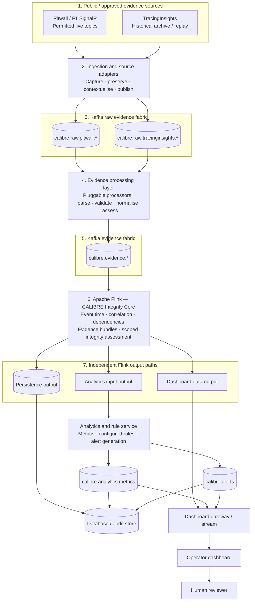
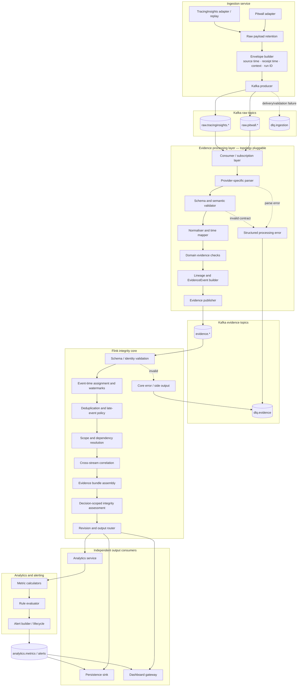

# CALIBRE — System Architecture: High-Level and Low-Level Design

| Document control | Value |
|---|---|
| Document ID | CAL-DOC-005 |
| Version | 1.0-draft |
| Date | 1 November 2026 |
| Status | Target architecture baseline |
| Parents | CAL-DOC-001 through CAL-DOC-004 |

## 1. Architecture summary

CALIBRE is an event-driven evidence-integrity platform. Source acquisition is separated from interpretation. Kafka buffers and distributes raw evidence to a replaceable evidence-processing layer. That layer publishes versioned evidence events. Apache Flink is the central core for event-time handling, evidence correlation, dependency-aware integrity assessment and output routing.

Flink routes outputs through three distinct paths:

1. **Persistence:** durable evidence, bundles, assessments, metrics, alerts and revision history.
2. **Dashboard delivery:** continuous operational state, current data, integrity state and display-ready summaries.
3. **Analytics:** integrity-aware input for derived metrics and operational rule evaluation. Analytics publishes metrics and human-review alerts back to Kafka for dashboard and persistence consumption.

The evidence-processing layer is intentionally defined by contracts and capabilities, not a fixed agent count or current source-code structure. It will be redesigned during scaffold implementation without changing the platform-level boundaries.

## 2. Architecture principles

- Preserve source payload and lineage before interpretation.
- Keep ingestion free of business rules and final integrity decisions.
- Use Kafka for buffering, fan-out, replay and service decoupling.
- Permit the evidence processor topology to change independently of the rest of the system.
- Preserve time semantics; never correlate purely by message arrival order.
- Use Flink for stateful event-time correlation and decision-scoped evidence integrity.
- Separate integrity status from operational rule outcome.
- Keep persistence, dashboard and analytics as independent consumers.
- Treat unknown, late, missing and contradictory data explicitly.
- Keep Phase 1 read-only with human review; no automatic external-system actuation.

## 3. High-Level Design (HLD)

### 3.1 HLD Mermaid diagram



### 3.2 HLD layer explanation

| Layer | Purpose | Input | Output |
|---|---|---|---|
| Evidence sources | Supply live or historical motorsport data. | External source availability. | Provider messages or archive files. |
| Ingestion | Capture, identify, preserve and publish source evidence. | Source payloads. | `RawSourceEnvelope`. |
| Kafka raw fabric | Decouple producers from consumers; support buffering, replay and fan-out. | Raw envelopes. | Raw events to independent processor groups. |
| Evidence processing | Parse source formats, normalise fields/time, apply bounded domain checks and produce traceable evidence. | Raw envelopes. | `EvidenceEvent` and processing errors. |
| Kafka evidence fabric | Decouple evidence producers from Flink. | Evidence events. | Evidence streams. |
| Flink integrity core | Perform stateful event-time alignment, dependency-aware correlation, bundling and integrity assessment. | Evidence events. | Bundles, assessments and downstream messages. |
| Persistence path | Retain audit and operational history. | Core and analytics outputs. | Queryable history. |
| Dashboard path | Deliver continuous display-ready data. | Current state, metrics and alerts. | UI stream/state. |
| Analytics path | Calculate metrics and evaluate configured operational rules. | Integrity-aware bundles/assessments. | Metrics and human-review alerts. |
| Human review | Inspect and disposition alerts. | Alert and supporting evidence. | Acknowledgement/disposition event. |

### 3.3 Why the three output paths are separate

**Persistence** is optimised for retention, auditability, lookup and historical investigation. A slow database must not stall dashboard display or analytics processing.

**Dashboard delivery** is optimised for continuous state updates and visualisation. The UI should consume ready-to-display information and should not become the authoritative integrity or rule engine.

**Analytics** is responsible for derived metrics, operational rule evaluation and alert generation. It receives Flink's integrity-aware result so it can distinguish a genuine rule condition from a condition that cannot be evaluated reliably because evidence is incomplete or suspect.

Analytics metrics and alerts are published back to Kafka and are then available to the dashboard and persistence consumers.

## 4. Low-Level Design (LLD)

### 4.1 LLD Mermaid component diagram



### 4.2 LLD component responsibilities

#### A. Ingestion service

- Maintains one adapter per source family or acquisition mode.
- Captures exact provider payloads or a stable reference to the retained object.
- Adds acquisition metadata without rewriting source fields.
- Produces a `RawSourceEnvelope` and publishes to the provider-specific raw topic.
- Supports live capture and historical replay through the same downstream envelope contract.
- Reports source connection state, publication failures and replay context.
- Does not parse data into final domain conclusions or calculate rule outcomes.

#### B. Kafka raw evidence fabric

- Holds raw provider events independently of processor implementation.
- Enables independent fan-out to multiple processor services.
- Uses consumer groups so every processor that requires a record receives its own copy.
- Supports retention/replay according to the configured environment.
- Routes invalid or unprocessable events to a dead-letter/error path with source references.

#### C. Evidence processing layer

This layer is a platform boundary, not a commitment to the current `Agents/` folder structure. The internal design may use separate services, a shared worker pool, libraries, processes or another topology. The only mandatory external behaviour is:

1. Consume applicable raw envelopes.
2. Parse and validate provider-specific structures.
3. Apply source-specific field, unit and timestamp semantics.
4. Preserve lineage to raw event IDs and payload references.
5. Emit structured evidence events and findings.
6. Report parsing/validation failures with sufficient context for replay and debugging.

Domain capabilities may include vehicle/sensor observations, track/incident state, environmental context, timing/session state and system/source integrity. These are logical coverage areas; they do not fix the number or identity of agent processes.

#### D. Flink integrity core

- Validates EvidenceEvents and their identities.
- Assigns event time only where justified by explicit time semantics.
- Maintains event-time state and source-specific watermark/allowed-lateness behaviour.
- Deduplicates repeated delivery and manages late-event acceptance/revision.
- Resolves scope and evidence dependencies.
- Correlates evidence across providers/processors without assuming independence.
- Assembles EvidenceBundles for a defined decision context.
- Emits scoped IntegrityAssessments with explanation, status, maturity and revision links.
- Routes outputs to independent downstream paths.

Detailed integrity algorithms, exact window policies, state representation and assessment thresholds are intentionally reserved for CAL-DOC-006 and the later implementation specification.

#### E. Analytics and rule service

- Consumes integrity-aware outputs from Flink.
- Calculates operational metrics and derived time series.
- Evaluates separately versioned rules against configured inputs.
- Distinguishes `RULE_BREACH`, `RULE_CLEAR`, `RULE_DEFERRED` or equivalent outcomes from integrity status.
- Publishes explainable alerts with scope, severity, rule version and evidence references.
- Supports human acknowledgement and disposition through a separate review event.

#### F. Persistence sink

- Consumes core and analytics outputs independently.
- Stores source references, evidence, bundles, assessments, metrics, alerts and revisions.
- Preserves audit history; does not overwrite prior evidence/assessment versions.
- Database engine and physical schema remain open design decisions.

#### G. Dashboard gateway

- Consumes current operational data, integrity assessments, analytics metrics and alerts.
- Maintains display-oriented current state and pushes updates to the UI.
- Supports drill-down to source/evidence references.
- Does not recalculate integrity or rule outcomes as an authoritative service.

## 5. Processing sequence

```mermaid
sequenceDiagram
    autonumber
    participant S as Public source
    participant I as Ingestion
    participant KR as Kafka raw
    participant P as Evidence processor(s)
    participant KE as Kafka evidence
    participant F as Flink core
    participant DB as Persistence
    participant D as Dashboard gateway
    participant A as Analytics
    participant H as Human reviewer

    S->>I: Source message / archive record
    I->>I: Preserve payload; attach provider, feed and receipt metadata
    I->>KR: RawSourceEnvelope
    KR-->>P: Independent delivery to applicable processors
    P->>P: Parse, validate, normalise, preserve lineage
    P->>KE: EvidenceEvent(s) and findings
    KE-->>F: Evidence streams
    F->>F: Event-time alignment, dependencies, correlation and assessment
    par Independent outputs
        F->>DB: Evidence bundle / integrity assessment
        F->>D: Operational state / evidence summary
        F->>A: Integrity-aware analytics input
    end
    A->>A: Calculate metrics and evaluate rules
    A->>D: Metrics and human-review alerts
    A->>DB: Persist metrics and alerts
    D->>H: Display alert and supporting evidence
    H-->>A: Acknowledge / disposition event
```

## 6. Time alignment and scope

### 6.1 Time model

A record may carry several distinct temporal values:

- source absolute timestamp;
- session elapsed seconds;
- lap-relative seconds;
- lap duration;
- receipt timestamp;
- processing timestamp.

They are separate fields and must not overwrite one another. Event time is a normalised processing-time basis, not a guess.

### 6.2 Verified historical mappings

For current TracingInsights examples:

- per-lap telemetry `time` is relative to the start of that lap;
- when a valid matching lap-start `lST` exists, session elapsed time may be derived as `lST + telemetry.time`;
- lap timing `time` is lap duration, while `sesT` and `lST` carry distinct session-time meanings;
- weather `wT` is session elapsed seconds;
- race-control `time` is an absolute timestamp in the supplied sample and requires `t0_date` for a supported conversion to session elapsed time.

### 6.3 Scope

Flink must retain scope rather than flattening all events into one global timeline. A weather sample may be session/track-level, a yellow flag may be sector-level, a telemetry sample may be driver/lap-level, and a source-health event may be feed-level. Correlation rules must respect these differences.

## 7. Failure, recovery and replay

- Source adapters retry with bounded policies and publish source health.
- Raw payload retention allows reprocessing after parser corrections.
- Kafka consumer groups resume from committed offsets according to the configured delivery model.
- Processors must be idempotent or emit stable logical identities for duplicate suppression.
- Flink checkpoints and state recovery preserve processing continuity; exact configuration is deployment-specific.
- Late evidence may produce a revised assessment; prior revisions remain auditable.
- Persistence, dashboard and analytics are isolated so one sink failure does not automatically stop the other two.
- Dead-letter messages preserve the input reference, component, version, error and retry disposition.

## 8. Deployment topology — initial target

The first target is a local or single-host development deployment with logical separation between:

- source ingestion;
- Kafka broker;
- evidence processing worker(s);
- Flink job manager/task manager or equivalent local Flink runtime;
- persistence sink/database;
- dashboard gateway/UI;
- analytics/rule service.

These are logical deployment roles. They may share a host in development and be separated in later deployments. Production sizing, container orchestration, high availability, replication and disaster recovery are not finalised here.

## 9. Observability

The architecture must expose health and lag at every boundary:

- source connection state, last event time and last receipt time;
- ingestion received/published/failed counts;
- Kafka topic throughput, consumer lag and partition health;
- processor throughput, validation failures and processing latency;
- Flink watermarks, late events, checkpoint status, backpressure and output rates;
- bundle/assessment counts by integrity state and maturity;
- analytics evaluations, deferred rules, alert counts and alert lifecycle transitions;
- output delivery lag and sink failures.

Every log should include a traceable event/run/session identifier where available. Payload contents should not be dumped without bounds.

## 10. Architecture decisions and open items

| ID | Decision / open item | Baseline |
|---|---|---|
| ADR-001 | Event transport | Kafka. |
| ADR-002 | Central stream-processing core | Apache Flink. |
| ADR-003 | Source configuration | Pitwall free live topics and TracingInsights public historical repositories. |
| ADR-004 | OpenF1 and F1 static archive | Excluded from current active path due to observed HTTP 401 responses. |
| ADR-005 | Evidence processor topology | Pluggable; final structure to be redesigned. |
| ADR-006 | Integrity vs analytics | Separate responsibilities and outputs. |
| ADR-007 | Human authority | Human review; no automatic external actuation in Phase 1. |
| ADR-008 | Typed-Time and Run-Clock Fact Model | Explicit `TypedTime` classes with legal conversion rules; discrete durable `RunClockTick` facts drive monotonic progress without synthetic watermarks. |
| ADR-009 | Content Hash Decoupling & Reproducibility R1/R2 | Cryptographic RFC 8785 JCS SHA-256 hashes exclude non-deterministic runtime state; R1 evaluator and R2 log replay determinism enforced. |
| ADR-010 | Fault Isolation via Minimal Admissible Diagnoses | Fault isolation theorem G4-I: isolate and exclude strictly the intersection $\bigcap \mathcal{D}_{\min}$ of minimal hitting sets; if empty, exclude nothing (ambiguous). |
| ADR-011 | Live vs Replay Axis & Flink Job Isolation | Separate Flink streaming jobs (`calibre-flink-live` vs `calibre-flink-replay`) with partition key `session_instance_id` and distinct lease clock domains. |
| TBD-001 | Exact Kafka partition/retention policy | Determine after payload volume and replay requirements are measured. |
| TBD-002 | Exact Flink event-time and lateness policy | Determine after live topic cadence/semantics are tested. |
| TBD-003 | Database and dashboard technologies | Select during implementation. |
| TBD-004 | Analytics rule model and configuration | Specify after the core event contracts are stable. |
| TBD-005 | Production deployment/HA | Defer until load and reliability targets are measured. |

## 11. Implementation status

This document describes the target platform, not a claim that the full pipeline currently exists. The source viewer and historical retrieval path have been exercised locally; a first local evidence-processing scaffold has been explored but is expected to be redesigned. Kafka production/consumption, integrated Flink processing and the three output paths remain implementation work.
