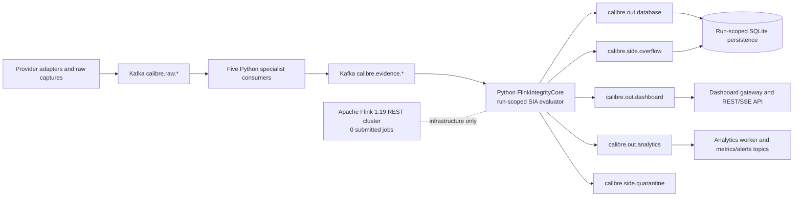
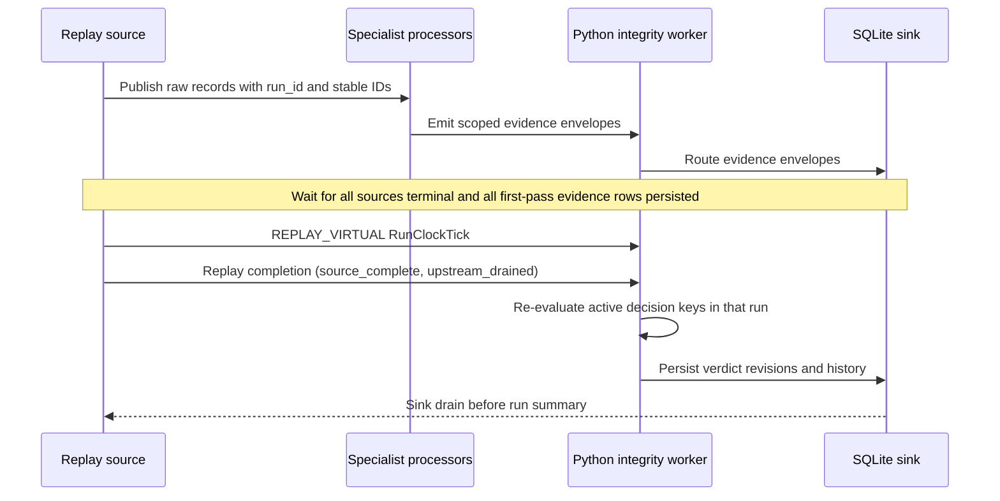

# Monaco 2026: forensic execution and recovery report

**Run date:** 2026-11-01  
**Runtime:** WSL2; Docker Compose, Kafka, Zookeeper, and Apache Flink REST were accessed from WSL.  
**Full replay:** `monaco2026-wsl-full-02`  
**Recovery replay:** `monaco2026-wsl-recovery-12` (200 source records)  
**Purpose:** Validate universal accounting and evidence semantics. Monaco is a baseline capture; race results and later findings were not evaluator inputs.

> **Report precedence:** The original execution and its measured discrepancies are preserved below as a historical baseline. The closure update describes the current code and later WSL runs; it supersedes earlier statements about missing `car_data`, overflow, finality behavior, test counts, and current service state. The untouched pre-fix report is also preserved at [MONACO_2026_FORENSIC_RECONCILIATION.baseline-2026-11-01.md](MONACO_2026_FORENSIC_RECONCILIATION.baseline-2026-11-01.md).

## Closure update — current code and WSL evidence

### Verification matrix

| Status | Finding |
|---|---|
| **VERIFIED** | Current WSL regression suite: `76 passed in 18.95s`; project modules compile. The final 200-record `car_data` recovery run accounted for all 200 sources as `PERSISTED`, emitted 400 specialist evidence events on the first pass, routed 800 deliveries over both passes, persisted 400 unique evidence rows, and recorded zero overflow. `source_outcomes_drained=true` and `evidence_writes_drained=true` before replay completion. With live workers running concurrently, restarting the SQLite sink and replaying identical IDs preserved 231/231 unique verdict hashes; second-pass verdict emissions were zero. Independent hash and revision-chain verification found zero mismatches. All 22 raw telemetry drivers are captured. API, Kafka, sinks, Docker services, and current live Kafka groups are connected; live sink lag is zero. |
| **PARTIALLY VERIFIED** | The full 2,015-record four-feed replay belongs to the earlier code version. Current end-to-end evidence covers a bounded 200-record telemetry slice, not the combined 589,767-record inventory. Ten bounded-run messages were quarantined by `MISSING_DECISION_SCOPE_FIELD:lap_number` for `vehicle_sensor_anomaly`, without changing source terminal outcomes. The 1,525 historical overflow records are now individually classified by witness and joined to the source ledger; all corresponding source rows were persisted. Their full-race remediation has not been rerun against current code. Explicit queue occupancy/capacity/high-water/deferred/rejected metrics and queue-level backpressure reporting remain unimplemented. Historical lap rows remain 1,452 versus 1,445 classified laps; seven duration-null rows are not individually reconciled. |
| **NOT VERIFIED** | No assessment in the current bounded run reached `TUPLE_RESOLVED` or `FINAL`; 231 assessments remain finality `OPEN` because the replay used `--feed`, `--from-time`, and `--limit`. A single unfiltered full-session run of all feeds, all 587,752 car-data rows, all downstream sinks, and full-replay finality remains unverified. A native Apache Flink REST cluster reports zero submitted jobs; the executed `FlinkIntegrityCore` is the Python Kafka worker. Native Flink execution/checkpoint recovery and current-code full-race remediation of the historical overflow workload are not verified. |
| **BLOCKED** | A DEC-level throttle/brake fault claim is blocked by the missing contract-level `sensor_envelope` evidence role. The vehicle agent emitted an actual raw-channel overlap screening finding, but its own limitation says it does not establish a sensor fault or driver-input error. Keep the DEC assessment unresolved/UNKNOWN where required; do not infer an ECU fault from the screening signal. |

**Current conclusion:** The bounded source accounting, telemetry ingestion, Python worker routing, persistence recovery, hash reproducibility, and API readiness are verified. The backend is **not fully verified** for a complete race replay or native Apache Flink execution. Monaco remains a baseline input only; no final race results or post-race failure labels are sent into evaluation.

### Current raw telemetry capture

`EDA/data/raw/car_data_session_11299.json` contains **587,752** retained OpenF1 records, 26,716 for each of the **22** classified drivers. The adjacent provenance file reports `coverage_status=COMPLETE`, no unavailable intervals, no missing required fields, and SHA-256 `cd96f38dfd94a50cf58ced73dc02847279f97b04a88bed15c4c61aee530d4037`. The provider query was bounded by session key and driver; records outside authoritative session bounds were excluded locally (397,166 provider rows). This capture is real provider data, not synthetic data. Its presence does not mean all 587,752 rows were replayed end to end.

The provider `date` value is retained as UTC event time. Raw range screens found throttle=104 in 93,585 rows and brake=104 in 93,604 rows. The value 104 is preserved and flagged outside the documented 0–100 percentage range; it is not clamped or assigned a physical meaning. Valid in-range samples are independently screened. Example from the current replay: raw throttle 23%, brake 100%, threshold 20%; the emitted finding is `THROTTLE_BRAKE_OVERLAP_SCREEN` and explicitly says it does not establish a sensor fault or driver input error. DEC sensor verdicts do not claim throttle/brake correlation as a contract-level result.

The 1,452 lap-feed rows still differ from the 1,445 completed laps in the 22-driver classification. Seven rows have null duration; the row-level cause is not reconciled. OpenF1 rainfall is an **observed rainfall condition**, not a probability forecast. The former “20 drivers” statement was wrong for the official driver/classification inventory and is corrected to 22.

### Historical overflow forensic reconciliation

The baseline `calibre.side.overflow` topic contains **1,525** records at partition 0, offsets 9,896–11,420. The topic payloads were read and grouped by contract, witness, and correlation. Every correlation joined to one row in `data/monaco_wsl_full_run_02.db`'s `replay_inputs` source ledger; there were zero unmapped correlations, and all 1,525 matched source rows had terminal outcome `PERSISTED`:

```text
overflow_rows=1525
by_contract={pit_lane_timing_evidence: 1327, weather_strategy_advisory: 198}
unique_decision_instances=22
by_witness_prefix={SEARCH_BUDGET_EXCEEDED: 1525}
unique_correlations=1525 source_rows_mapped=1525 unmapped_correlations=0
mapped_source_feeds={laps: 1247, pit: 80, weather: 198}
mapped_source_terminal_outcomes={PERSISTED: 1525}
observed_candidate_count_min=11 observed_candidate_count_max=208 configured_M_max=10
overflow_topic_partition_set=[0] overflow_topic_offsets=9896..11420
legacy_rows_with_source_event_id=0 rows_with_source_topic=0
```

The records describe **evaluation search-budget exhaustion**, not missing, filtered, or failed source ingestion. Source IDs can be recovered through the correlation-to-ledger join, but the legacy overflow payloads themselves lack `source_event_id`, source topic, and source Kafka coordinates. Current code applies simultaneity-window and hard-age pruning before enforcing the same `M_max`; a bounded telemetry recovery currently produced zero overflow. That is evidence the bounded path is clean, not proof that the full historical workload is fixed. The full four-feed replay has not been rerun after this change, so full-race overflow remediation remains **NOT VERIFIED**. Queue occupancy, capacity, high-water, deferred, rejected, and explicit backpressure measurements also remain unavailable.

Representative legacy payload:

```json
{"decision_instance_id":"monaco_2026#race:monaco2026-wsl-full-02|session|weather_strategy_advisory","witness":"SEARCH_BUDGET_EXCEEDED: count=11, M_max=10 SLOT_DEADLINE_EXPIRED: role=air_weather, slot=0 UNMODELLED_COMMON_CAUSE: shared F1 timing upstream","occurred_at_utc":"2026-11-01T16:23:53.312+00:00","verdict_hash":"41c540ca6f8902d854f20c5383df1a4a7ac327335909cbc02a747795c37a537b","correlation_id":"monaco2026-wsl-full-02:weather:00011"}
```

The `occurred_at_utc` value is verdict emission time, not a replay virtual timestamp. Replay lease metadata remains separate from integrity witnesses.

### Current WSL recovery replay

Final command executed from `/mnt/e/CALIBER` with the persistent live WSL workers also active:

```bash
python3 run_monaco_full_race.py --feed car_data \
  --from-time 2026-06-07T13:03:12Z --limit 200 --recovery-test \
  --run-id closure-20261102-car-data-recovery-verified
```

Measured summary output:

```text
source_records_expected=200 source_records_published=200 source_publish_failures=0
source_outcomes={PERSISTED: 200}; pending=0 failed=0 filtered=0 unaccounted=0
expected_evidence_events=400; first pass received/routed=400/400
recovery replay received/routed=800/800; duplicate_evidence_events=400
overflow_events=0; quarantined_events=10; replay_completions=1
source_outcomes_drained=True; terminal_source_records_before_completion=200
evidence_writes_drained=True (400 first-pass evidence rows acknowledged before completion)
DEC invocations=232; verdict emissions=232; unique decisions=21
persisted evidence rows=400; persisted verdict rows/hashes=231/231
first sink drain=True; second sink drain=True; recovery_hashes_reproducible=True
duplicate event deliveries=400; duplicate verdict deliveries=1
second-pass verdict emissions=0; recovery replay source records=200
```

Python `FlinkIntegrityCore` metrics for the two-pass bounded run:

```text
contracts_loaded=11 active_decisions=21
events_received=800 events_routed=800 events_malformed=0
verdicts_emitted=232 dec_evaluation_invocations=232
overflow_events=0 quarantined_events=10
clock_ticks=2 replay_completions=1 duplicate_evidence_events=400
```

This final recovery ran while the separate `backend-live-20261102-final` workers were active. Live and replay consumers filtered shared Kafka topics by run scope; the replay retained the same counts as the isolated run. The ten quarantine records are `MISSING_DECISION_SCOPE_FIELD:lap_number` for `vehicle_sensor_anomaly`, with run ID, event ID, raw event ID, and correlation ID present. They are scope-limited evidence envelopes, not source drops; the source ledger records every source row as persisted. The run-scoped persistence snapshot remained 400 evidence rows and 231 verdict hashes on both passes.

Kafka topic offset deltas from the run summary:

```text
calibre.raw.openf1.car_data       400
calibre.evidence.vehicle          400
calibre.evidence.system           400
calibre.guard.clock                 2
calibre.core.verdict_history      232
calibre.out.database             1032
calibre.out.dashboard            1032
calibre.out.analytics            1032
calibre.side.overflow               0
calibre.side.quarantine            10
```

`calibre.out.*` includes more than verdicts (evidence, health/analytics, and replay output), so those topic totals must not be equated with verdict counts. The 232 verdict-history messages include one duplicate verdict delivery; SQLite contains 231 unique hashes. The ten quarantine messages are downstream handling and do not change the 200 `PERSISTED` source outcomes. Their presence remains visible in Kafka and run metrics.

Per-agent durable receipt output for this telemetry-only run:

```text
vehicle_twin_sensor_agent: consumed=200, emitted=200 per pass, attempts=400 across replay, errors=0
vehicle_electronics_system_integrity_agent: consumed=200, emitted=200 per pass, attempts=400 across replay, errors=0
```

The historical full four-feed run establishes the other relevant specialists: incident 269 race-control inputs, environment 208 weather inputs, timing 1,538 lap+pit inputs, and system-integrity 2,015 inputs. The current car-data slice establishes the vehicle-twin agent's real consumption and emission. These two complementary runs demonstrate all five specialists actually processed relevant event types; the car-data-only run correctly shows the other three at zero.

SQLite queries against `data/monaco_closure-20261102-car-data-recovery-verified.db`:

```sql
SELECT feed, terminal_status, count(*) AS rows, sum(evidence_count) AS evidence
FROM replay_inputs
WHERE run_id='closure-20261102-car-data-recovery-verified'
GROUP BY feed, terminal_status;

SELECT processor_id, status, count(*) AS receipts,
       sum(emitted_total) AS emitted, sum(attempts) AS attempts
FROM replay_agent_receipts
WHERE run_id='closure-20261102-car-data-recovery-verified'
GROUP BY processor_id, status;

SELECT domain, feed, count(*) AS rows
FROM persisted_events
WHERE correlation_id LIKE 'closure-20261102-car-data-recovery-verified:%'
GROUP BY domain, feed;

SELECT integrity_state, resolution_maturity, finality_status, count(*)
FROM persisted_verdicts
WHERE decision_instance_id LIKE
 'monaco_2026#race:closure-20261102-car-data-recovery-verified|%'
GROUP BY 1,2,3;
```

Actual SQLite output:

```text
car_data PERSISTED 200 source rows; evidence_count=400
vehicle_electronics_system_integrity_agent EMITTED 200 receipts; emitted_total=400; attempts=400
vehicle_twin_sensor_agent EMITTED 200 receipts; emitted_total=400; attempts=400
system/car_data 200 persisted rows; vehicle/car_data 200 persisted rows
OPEN / OPEN / PROVISIONAL = 21
OPEN / OPEN / REVISED = 63
DEGRADED / STATE_RESOLVED / REVISED = 147
```

Thus, by **resolution maturity**, OPEN=84, STATE_RESOLVED=147, TUPLE_RESOLVED=0. By **finality**, OPEN=231 and FINAL=0. The 210 REVISED assessments are revisions (63 still resolution-OPEN and 147 STATE_RESOLVED), not a finality state. The current representative DEC witness is `SLOT_DEADLINE_EXPIRED: role=sensor_envelope, slot=1`; another observed witness is an unresolved RPM conflict. Neither proves a complete sensor envelope. One persisted agent finding records the raw 23%/100% sample above and carries the limitation that it is a screen only.

Independent current-run verdict verification:

```text
rows=231 unique_hashes=231 unique_decisions=21 hash_mismatches=0 revision_chain_errors=0
```

Hash recomputation used each persisted verdict's exact `hash_basis`, contract identity, frontier, corroboration profile, validity timeline, and sorted support/reference IDs. Revision checks confirmed contiguous revision numbers and previous-hash links within each decision history. The bounded replay's stable hash-set comparison is separate evidence that the sink restart/replay did not change those hashes.

### API, sinks, and runtime status in WSL

`/v1/health/ready` returned `{"status":"READY","dashboard_consumer_running":true,...}`. `/v1/system/status` reported Kafka CONNECTED with 31 topics, Flink REST CONNECTED, and SQLite CONNECTED. Kafka topics include `calibre.raw.openf1.car_data`, all five `calibre.evidence.*` topics, `calibre.core.verdict_history`, `calibre.side.overflow`, `calibre.side.quarantine`, and all three `calibre.out.*` sinks. Docker Compose reported healthy Kafka, ZooKeeper, and Flink JobManager, plus a running TaskManager. Flink REST returned version 1.19.3, one TaskManager, two available slots, and `jobs-running=0`, `jobs=[]`. A fresh WSL recheck during this report edit could not start the WSL instance (`Wsl/Service/CreateInstance/E_ACCESSDENIED`), so these are the last successfully captured runtime outputs, not a new post-edit health sample.

The current API exposes `/v1/health/live`, `/v1/health/ready`, `/v1/system/status`, `/v1/sources`, `/v1/assessments`, `/v1/agents`, `/v1/runs/{run_id}`, `/v1/decisions/{decision_instance_id}`, `/v1/decisions/{decision_instance_id}/at`, and `/v1/stream/events`, plus the existing root/recent/metrics/trace routes. A live run with no newly injected events correctly returns an empty agent list; its consumers are connected and ready. Five specialist groups, the Python integrity worker, persistence, dashboard, and analytics have distinct `backend-live-20261102-final` Kafka consumer groups. The recovery run has its own isolated groups.

The API's configured legacy database reports 4,093 evidence rows and 9,327 verdict rows at the final status check. These are mixed-history totals, not current-run counts. During this verification, reusing the old `backend-live-20261101` run ID resumed its committed Kafka offsets and began processing older topic backlog; that worker was stopped. Its persistence group retained 50,781 records of lag. No rows were deleted or rewritten to hide that history. The final live ID, `backend-live-20261102-final`, attached at current topic ends; the integrity and persistence groups reported zero lag while the bounded replay ran concurrently. Use a new run ID for a new live session; intentionally reuse an ID only to resume that run's offsets. Direct queries of the shared database for `closure-20261102-car-data-recovery-verified` returned zero evidence rows and zero verdict rows; the run's 400 evidence rows and 231 verdict rows are only in its run-specific DB. Replay-domain bitemporal lookup and wrong-domain rejection were previously exercised via the API; legacy columns ending in `_utc` still require clients to use the explicit clock domain. Lease clock/timestamp semantics are metadata. `REPLAY_VIRTUAL_LEASE_ASSIGNED` is not emitted as an integrity witness.

### Actual component and replay-barrier diagrams





### WSL operation and verification commands

Start infrastructure and the API in WSL:

```bash
cd /mnt/e/CALIBER
docker compose up -d
export CALIBRE_KAFKA_BOOTSTRAP=127.0.0.1:9092
export CALIBRE_PERSISTENCE_DB=/mnt/e/CALIBER/data/calibre_persistence.db
uvicorn api:app --host 127.0.0.1 --port 8000
```

In another WSL shell, use a **new** live run ID and start workers, or run a complete unfiltered replay in its own shell. Full replay command (not yet executed on the combined 589,767-record inventory):

```bash
cd /mnt/e/CALIBER
python3 run_pipeline.py run --run-id backend-live-$(date -u +%Y%m%dT%H%M%SZ)

# Full, unfiltered source set; no --feed, --from-time, or --limit flags.
python3 run_monaco_full_race.py --run-id monaco-2026-full-$(date -u +%Y%m%dT%H%M%SZ) --delay 0.001
```

Stop a worker with Ctrl+C. To stop all Docker infrastructure after workers/API stop, use `docker compose down`. Verify API, cluster, job list, and live sink offsets:

```bash
curl -fsS http://127.0.0.1:8000/v1/health/ready
curl -fsS http://127.0.0.1:8000/v1/system/status
curl -fsS http://127.0.0.1:8081/overview
curl -fsS http://127.0.0.1:8081/jobs/overview
docker exec calibre-kafka kafka-consumer-groups --bootstrap-server localhost:9092 \
  --describe --group calibre-persistence-sink-group-backend-live-20261102-final
```

Run-scoped database checks:

```sql
-- Source accounting and terminal outcomes
SELECT feed, terminal_status, count(*)
FROM replay_inputs
WHERE run_id='closure-20261102-car-data-recovery-verified'
GROUP BY feed, terminal_status;

-- Durable processor receipts; emitted evidence is separate from consumed inputs
SELECT processor_id, status, count(*) AS receipts,
       sum(emitted_total) AS emitted, sum(attempts) AS attempts
FROM replay_agent_receipts
WHERE run_id='closure-20261102-car-data-recovery-verified'
GROUP BY processor_id, status;

-- Persisted overflow with Kafka coordinates and reason codes
SELECT run_id, reason_code, source_topic, source_partition, source_offset,
       kafka_topic, kafka_partition, kafka_offset, count(*)
FROM persisted_overflows
WHERE run_id='closure-20261102-car-data-recovery-verified'
GROUP BY run_id, reason_code, source_topic, source_partition, source_offset,
         kafka_topic, kafka_partition, kafka_offset;

-- Run isolation: this query must return exactly the requested session instance
SELECT count(DISTINCT decision_instance_id), count(*) AS assessments
FROM persisted_verdicts
WHERE decision_instance_id LIKE
 'monaco_2026#race:closure-20261102-car-data-recovery-verified|%';

-- Shared legacy DB must not absorb this run's isolated replay rows
SELECT count(*) AS leaked_evidence
FROM persisted_events
WHERE correlation_id LIKE 'closure-20261102-car-data-recovery-verified:%';
SELECT count(*) AS leaked_verdicts
FROM persisted_verdicts
WHERE decision_instance_id LIKE
 'monaco_2026#race:closure-20261102-car-data-recovery-verified|%';

-- Verdict maturity, finality, and revision totals
SELECT resolution_maturity, finality_status, count(*)
FROM persisted_verdicts
WHERE decision_instance_id LIKE
 'monaco_2026#race:closure-20261102-car-data-recovery-verified|%'
GROUP BY resolution_maturity, finality_status;

-- Revision chain
SELECT decision_instance_id, revision_number, previous_verdict_hash, verdict_hash
FROM persisted_verdicts
WHERE decision_instance_id LIKE
 'monaco_2026#race:closure-20261102-car-data-recovery-verified|%'
ORDER BY decision_instance_id, revision_number;
```

Shared database isolation query output:

```text
leaked_evidence=0
leaked_verdicts=0
```

## Historical baseline status (pre-closure code)

| Status | Result |
|---|---|
| **VERIFIED** | The full run recorded all 2,015 source records as `PERSISTED`, emitted and routed 4,030 specialist evidence events, and persisted all 4,030. The 12,309 database, dashboard, and analytics output-topic messages drained. A 200-record sink interruption/replay test preserved all 799 verdict hashes and did not add verdicts on the duplicate pass. All 8,279 verdict hashes in the full-run DB recompute from the persisted JCS basis; all previous-hash links are contiguous. API route smoke checks and an explicit replay-domain bitemporal lookup passed. |
| **PARTIALLY VERIFIED** | Four relevant specialists processed inputs. The vehicle-twin sensor specialist processed zero because the raw capture has no `car_data`. The full replay produced 1,525 overflow events. Worker-level Python Kafka consumers and all three sinks ran; the Apache Flink cluster had no submitted jobs. |
| **NOT VERIFIED** | No assessment reached `TUPLE_RESOLVED` or `FINAL`. Therefore final verdict closure is not established. A finite replay clock tick was processed, but it did not make unresolved references/overflow into a resolved tuple. The 200-record recovery test proves bounded replay idempotence for this fixture and code path, not every failure mode or production durability guarantee. |
| **BLOCKED** | A Monaco throttle/brake anomaly assessment is blocked by absent raw `car_data`. The replay cannot infer sensor measurements from post-race knowledge, lap timing, or weather. The sensor verdict must remain UNKNOWN / NOT EVALUATED until admissible telemetry is supplied. |

**Overall:** The backend is useful for controlled universal replay and produces reproducible, traceable assessments, but it is **not fully verified or production-ready**. In particular, do not claim Monaco vehicle-sensor evaluation or final assessment closure.

## WSL commands and infrastructure evidence

The full replay command was run from `/mnt/e/CALIBER`:

```bash
python3 run_monaco_full_race.py \
  --run-id monaco2026-wsl-full-02 \
  --db-path data/monaco_wsl_full_run_02.db \
  --delay 0.001
```

The recovery command was:

```bash
python3 run_monaco_full_race.py \
  --run-id monaco2026-wsl-recovery-12 \
  --db-path data/monaco_wsl_recovery_run_12.db \
  --recovery-test --limit 200 --delay 0.001
```

`docker compose ps` output from WSL:

```text
NAME                        SERVICE             STATUS
calibre-flink-jobmanager    flink-jobmanager    Up 13 hours (healthy)
calibre-flink-taskmanager   flink-taskmanager   Up 13 hours
calibre-kafka               kafka               Up 13 hours (healthy)
calibre-zookeeper           zookeeper           Up 13 hours (healthy)
```

Flink REST output:

```json
{"taskmanagers":1,"slots-total":2,"slots-available":2,"jobs-running":0,
 "jobs-finished":0,"jobs-cancelled":0,"jobs-failed":0,
 "flink-version":"1.19.3","flink-commit":"4105f8d"}
{"jobs":[]}
```

The runtime named `FlinkIntegrityCore` in the report is the repository's Python Kafka consumer, not an Apache Flink job. Apache Flink was reachable and healthy, but no native Flink job was submitted. This distinction is reflected in all statuses below.

## 1. Source, evidence, route, and persistence reconciliation

Raw capture inventory and terminal outcomes:

| Feed | Captured and published | Terminal input outcome | Evidence envelopes emitted | Persisted evidence rows |
|---|---:|---|---:|---:|
| Laps | 1,452 | 1,452 `PERSISTED` | 2,904 (timing + system-integrity agents) | 2,904 |
| Pit | 86 | 86 `PERSISTED` | 172 (timing + system-integrity agents) | 172 |
| Race control | 269 | 269 `PERSISTED` | 538 (incident + system-integrity agents) | 538 |
| Weather | 208 | 208 `PERSISTED` | 416 (environment + system-integrity agents) | 416 |
| **Total** | **2,015** | **2,015 `PERSISTED`; 0 pending/failed/filtered/unaccounted** | **4,030** | **4,030** |

The original “2,015 evidence events” phrasing conflated source events and specialist evidence envelopes. This run had 2,015 distinct source records, 4,030 emitted evidence envelopes because multiple specialists consume the same source record, 4,030 envelopes routed by the Python integrity worker, and 4,030 evidence rows persisted. No evidence-envelope drop is present in this run. The 2015 source ledger accounts for source inputs; it is not the evidence-envelope count.

Run-ledger SQL and output:

```sql
SELECT feed, terminal_status, count(*)
FROM replay_inputs
WHERE run_id = 'monaco2026-wsl-full-02'
GROUP BY feed, terminal_status ORDER BY feed, terminal_status;

SELECT count(*) AS rows, count(DISTINCT correlation_id) AS source_correlations
FROM persisted_events WHERE correlation_id LIKE 'monaco2026-wsl-full-02:%';
```

```text
laps PERSISTED 1452
pit PERSISTED 86
rcm PERSISTED 269
weather PERSISTED 208
4030 2015
```

The second query has 4,030 rows and 2,015 source correlations by design: source correlation is shared by specialist evidence envelopes. The source ledger additionally records `publish_status`, `payload_sha256`, evidence count, and publish attempts. All terminal input rows are `PERSISTED`; there were no missing records requiring an inferred dedupe/filter/failure category.

## 2. Specialist input and emission counts

The output below is the run summary's durable receipt-backed count, not an estimate derived from contract verdicts:

| Specialist | Inputs consumed | Evidence emitted | Errors | Result |
|---|---:|---:|---:|---|
| `vehicle_twin_sensor_agent` | 0 | 0 | 0 | No `car_data` feed existed in the replay input set. |
| `incident_track_agent` | 269 | 269 | 0 | Processed all race-control records. |
| `environmental_context_agent` | 208 | 208 | 0 | Processed all weather records. |
| `race_timing_session_agent` | 1,538 | 1,538 | 0 | Processed 1,452 lap + 86 pit records. |
| `vehicle_electronics_system_integrity_agent` | 2,015 | 2,015 | 0 | Catch-all integrity/provenance processing across the four captured feeds. |

SQLite event provenance confirms the per-feed specialist emissions:

```sql
SELECT json_extract(event_json, '$.producer.processor_id') AS agent,
       feed, count(*) AS emitted, count(DISTINCT correlation_id) AS sources
FROM persisted_events
WHERE correlation_id LIKE 'monaco2026-wsl-full-02:%'
GROUP BY agent, feed ORDER BY agent, feed;
```

```text
environmental_context_agent weather 208 208
incident_track_agent rcm 269 269
race_timing_session_agent laps 1452 1452
race_timing_session_agent pit 86 86
vehicle_electronics_system_integrity_agent laps 1452 1452
vehicle_electronics_system_integrity_agent pit 86 86
vehicle_electronics_system_integrity_agent rcm 269 269
vehicle_electronics_system_integrity_agent weather 208 208
```

This demonstrates relevant processing by four specialists. It does not demonstrate sensor-specialist execution. An idle sensor agent is not counted as a successful signal evaluation.

## 3. DEC evaluations, verdict emissions, unique decisions, and revisions

The full run recorded 112 distinct decision instance IDs, 8,279 DEC evaluation invocations, and 8,279 verdict emissions. Every emitted full-run verdict is present with a distinct hash in the final run database. The 8,279 records are assessments/revisions; they are not 8,279 independent decisions.

| Contract | Decision instances | Persisted verdict rows / hashes |
|---|---:|---:|
| `lap_time_consistency` | 22 | 1,560 |
| `pit_entry_speed_evidence` | 22 | 1,560 |
| `pit_lane_timing_evidence` | 22 | 1,560 |
| `race_control_incident_timing` | 23 (22 driver-scoped + 1 session-scoped) | 1,830 |
| `telemetry_session_alignment` | 22 | 1,560 |
| `weather_strategy_advisory` | 1 session-scoped | 209 |
| **Total** | **112** | **8,279** |

SQL used:

```sql
SELECT contract_id, count(DISTINCT decision_instance_id) AS decisions,
       count(*) AS persisted_assessments
FROM persisted_verdicts
WHERE decision_instance_id LIKE 'monaco_2026#race:monaco2026-wsl-full-02|%'
GROUP BY contract_id ORDER BY contract_id;

SELECT count(*) AS assessments,
       count(DISTINCT verdict_hash) AS distinct_hashes,
       count(DISTINCT decision_instance_id) AS decisions,
       sum(revision_number > 1) AS revisions_after_initial
FROM persisted_verdicts
WHERE decision_instance_id LIKE 'monaco_2026#race:monaco2026-wsl-full-02|%';
```

```text
8279 assessments | 8279 hashes | 112 decisions | 8167 revisions after initial
```

The attached execution's DEC counts summing to 5,808 are from a different, mixed-scope database snapshot; they are not the counts for this run. The full-run summary initially undercounted session-scoped verdicts by 112 because it filtered all verdict rows by a source `correlation_id`; session-level verdicts have no single source correlation. The runner's run-scope SQL now uses the namespaced `decision_instance_id`. The counts above come from direct post-shutdown SQL against the complete full-run database, not by editing expected results.

The historical full-run summary also had a stale `persisted_verdict_rows` snapshot (8,167) for the same scope-selection reason. The post-shutdown SQLite query returns 8,279. Recovery run 12 used the corrected query and its persisted summary matches its database.

## 4. Kafka topic counts and Python stream-worker metrics

The runner captured end-offset deltas during `monaco2026-wsl-full-02`:

| Kafka topic | Run delta |
|---|---:|
| `calibre.raw.openf1.laps` | 1,452 |
| `calibre.raw.openf1.pit` | 86 |
| `calibre.raw.openf1.rcm` | 269 |
| `calibre.raw.openf1.weather` | 208 |
| `calibre.evidence.timing` | 1,538 |
| `calibre.evidence.incident` | 269 |
| `calibre.evidence.environment` | 208 |
| `calibre.evidence.system` | 2,015 |
| `calibre.evidence.vehicle` | 0 |
| `calibre.guard.clock` | 1 |
| `calibre.core.verdict_history` | 8,279 |
| `calibre.out.database` | 12,309 |
| `calibre.out.dashboard` | 12,309 |
| `calibre.out.analytics` | 12,309 |
| `calibre.analytics.metrics` | 2,461 |
| `calibre.side.overflow` | 1,525 |
| `calibre.side.quarantine` | 0 |
| `calibre.alerts` | 0 |

The three output topics contain three-way fan-out (evidence, verdict, and clock/control records), not 12,309 verdicts. The single-partition topic end-offset deltas are the Kafka message counts for this isolated run.

Run-scoped Python Flink-core metrics:

```text
contracts_loaded=11
events_received=4030  events_routed=4030  events_malformed=0
verdicts_emitted=8279  dec_evaluation_invocations=8279
overflow_events=1525  quarantined_events=0  identity_conflicts=0
duplicate_clock_ticks=0  clock_ticks=1
health=DEGRADED
```

`health=DEGRADED` is consistent with the measured overflow. The overflow side topic must be examined and mitigated through generic contract/search-budget or capacity work before claiming clean verification; the report does not discard those events.

## 5. Car data, weather, drivers, and laps

The runner read four raw files: laps, race control, weather, and pit. `EDA/data/raw/car_data_session_11299.json` does not exist. No throttle, brake, RPM, gear, or high-frequency speed telemetry was supplied to this run. There are zero vehicle-agent inputs and zero `calibre.evidence.vehicle` messages. The vehicle anomaly contract's throttle/brake cross-correlation was **not evaluated** and must be shown as UNKNOWN / NOT EVALUATED. Later proof that sensors were faulty is ground truth for offline evaluation only; it was not used to produce this replay's result.

Weather capture output:

```text
weather rows=208; rainfall=0 in 208/208 observations
```

OpenF1 documents `rainfall` as whether rainfall is present, an observed condition; it is not a probability forecast. See [OpenF1 API documentation](https://openf1.org/docs/). The UI and API must label this as observed rainfall, not “rain probability.”

Raw inventory output:

```text
drivers rows=22
session_result rows=22
laps=1452; duration_not_null=1445; duration_null=7; distinct lap drivers=22
classified number_of_laps sum=1445; distinct classified drivers=22
car_data_exists=False
```

Thus, 1,452 is the number of lap-feed rows; seven have no lap duration. The 1,445 duration-bearing lap samples equal the sum of classified completed laps. There are 22 drivers in the driver and classification captures. “20 drivers” describes neither of those tables; it may reflect the pit feed's driver coverage and must not be presented as the classification size.

## 6. Verdict witness and replay clock example

Representative persisted assessment:

```text
decision: monaco_2026#race:monaco2026-wsl-full-02|12|lap_time_consistency
revision: 1; hash: 4a8225e9f4f6526c22da075bba7216cad004a8f915deae36cd08b7f4e17f6462
integrity=UNKNOWN; resolution=OPEN; finality=OPEN
primary evidence witness: MISSING_REFERENCE_FACT: role=lap_start_reference, key=...|12
witness_set also includes: UNMODELLED_COMMON_CAUSE; HISTORICAL_ARCHIVE_UNCALIBRATED_LATENCY
lease metadata: clock_domain=REPLAY_VIRTUAL; timestamp_semantics=REPLAY_VIRTUAL
```

`REPLAY_VIRTUAL_LEASE_ASSIGNED` is not used as an evidence witness in the updated evaluator. Lease clock domain, lease deadline, and timestamp semantics are carried in `lease_metadata`; the primary witness and witness set describe the limiting evidence or result.

The table retains legacy column names `valid_time_utc`, `knowledge_time_utc`, and `lease_until_utc`. Those names are not sufficient to establish UTC semantics. Each verdict also carries `lease_clock_domain`, `run_clock_domain`, and `lease_metadata.timestamp_semantics`; this run's values are `REPLAY_VIRTUAL`. The API returns the parameters as `valid_time`, `knowledge_time`, and an explicit `clock_domain`; it does not relabel this virtual coordinate as UTC. The bitemporal route returned 200 for the exact `REPLAY_VIRTUAL` domain and 404 for `LIVE_UTC` on the same record. The legacy SQL column names remain a schema-cleanup risk and are called out for the UI to display the domain explicitly.

## 7. Finality and slot closure

Post-shutdown verdict counts from SQLite:

```text
OPEN / OPEN / PROVISIONAL = 112
OPEN / OPEN / REVISED    = 7968
STATE_RESOLVED / OPEN / REVISED = 199
TUPLE_RESOLVED = 0
FINAL = 0
```

The replay runner emitted one explicit final replay clock/watermark tick after source processing, and the Python worker counted `clock_ticks=1`; the 200-record recovery test counted its two first/duplicate clock ticks. The tick is not itself proof that each assessment is final. Contract evaluation preserves unresolved reference facts, pending roles, and search overflow as unresolved; FINAL also requires a tuple-resolved result. The representative lap decision remains OPEN because `lap_start_reference` is missing. The full run has 1,525 overflow events and no tuple-resolved assessment. Therefore the run clock message was processed, but completion of all required slot closures and final assessments is **NOT VERIFIED**. Do not promote OPEN results merely because the replay reached its end.

## 8. Bitemporal query, hash reproducibility, and revision history

The API bitemporal query checks decision ID, valid-time coordinate, knowledge-time coordinate, and clock domain. The WSL API smoke test returned the expected revision at the exact stored valid/knowledge coordinate for `REPLAY_VIRTUAL`; querying the same times under `LIVE_UTC` returned 404.

Independent full-run hash check recomputed each row with `compute_verdict_hash` from the stored contract, frontier, corroboration profile, validity timeline, and `hash_basis`:

```text
rows=8279 hash_recomputed=8279 hash_mismatches=0 revision_chain_errors=0
```

All 112 decision histories have revision 1 and subsequent revisions linked by `previous_verdict_hash`. There are 8,167 revisions after each decision's initial assessment. Revision count is not decision count and does not imply finality.

## 9. Consumer groups and sink recovery

Full and recovery groups use separate run IDs. Broker group listing showed distinct groups for all specialists, the Python integrity worker, persistence, dashboard, and analytics, for example:

```text
calibre-flink-core-group-monaco2026-wsl-full-02
calibre-persistence-sink-group-monaco2026-wsl-full-02
calibre-flink-core-group-monaco2026-wsl-recovery-12
calibre-persistence-sink-group-monaco2026-wsl-recovery-12
```

After a finite replay exits, its Kafka group has no active member; its committed offset remains. A later run's messages appear as lag relative to the stopped group's old end offset, which is expected for an isolated completed-run group and is not evidence that the earlier run failed to drain. The active `backend-live-20261101` workers use their own groups.

Recovery run 12 deliberately stopped the persistence sink during the first pass, restarted it to drain, replayed the same 200 source records, and drained after restart. Actual summary values:

```text
source_records_expected=200 source_records_published=200 source_outcomes=PERSISTED:200
evidence_events_per_first_pass=400
recovery_first_sink_drained=True recovery_second_sink_drained=True final_sink_drain=True
first snapshot: 400 evidence rows / 799 verdict hashes
second and post-shutdown snapshot: 400 evidence rows / 799 verdict hashes
duplicate event deliveries=400 duplicate verdict deliveries=0
second-pass verdict emissions=0
recovery_hashes_reproducible=True
```

This establishes deterministic duplicate handling and sink recovery for that replay slice. It does not prove native Apache Flink restart recovery because the native Flink job list was empty; the interrupted component was the Python persistence sink.

## 10. API and pipeline startup

The new API entry point is `api.py`, started in WSL with:

```bash
uvicorn api:app --host 127.0.0.1 --port 8000
```

Routes exercised successfully (HTTP 200): `/v1/health/live`, `/v1/health/ready`, `/v1/system/status`, `/v1/sources`, `/v1/assessments?limit=2`, `/v1/agents?run_id=monaco2026-wsl-full-02`, and `/v1/runs/monaco2026-wsl-full-02`. The bitemporal route was separately checked as described above. `/v1/agents` requires a `run_id`; a request without it correctly returns 422.

The persistent WSL workers were then started with `python3 run_pipeline.py run --run-id backend-live-20261101`. Kafka showed active, unique consumer groups for all five processors, the Python integrity worker, persistence, dashboard, and analytics. Uvicorn is listening at `http://127.0.0.1:8000`; the live HTTP health/status/source/assessment checks returned 200. The API and all worker processes use WSL. They start at the current topic boundary and do not consume old replay history.

The live `/v1/system/status` response reports Kafka `CONNECTED` (30 topics), Flink REST `CONNECTED`, and the configured SQLite sink `CONNECTED`. It reports zero running Apache Flink jobs. The API's dashboard subcomponent is `is_live=true`, `is_ready=true`, with no events yet and status `UNKNOWN`, which is an idle state rather than evidence of a failed connection. The default API database is the shared legacy `data/calibre_persistence.db` (currently 1,644 evidence rows and 5,808 verdict rows from mixed history); those counts are not scoped to either Monaco run. Set `CALIBRE_PERSISTENCE_DB` to a run database when inspecting a run-specific replay. A central multi-run registry remains future work.

The active persistence group was checked after startup:

```text
GROUP                                                TOPIC                CURRENT-OFFSET  LOG-END-OFFSET  LAG
calibre-persistence-sink-group-backend-live-20261101 calibre.out.database 111324          111324          0
```

## 11. Historical code and regression checks

Generic fixes in this work include run-scoped consumer groups and source ledger/receipts; deterministic agent replay output; Python stream-worker deduplication and conflict quarantine; replay clock progression; finality invariants; witness/lease separation; persisted hash basis; bitemporal queries with clock-domain filtering; and read-only API health, source, assessment, agent, run, and history hooks. These changes are provider/session-neutral; no contract special case was added for Monaco.

WSL checks:

```text
python3 -m py_compile run_monaco_full_race.py flink/job.py processors/service.py persistence/service.py dashboard/service.py analytics/service.py api.py
pytest -q tests/test_flink_streaming.py tests/test_persistence_durability_and_replay.py tests/test_evaluator.py tests/test_e2e_pipeline.py
44 passed in 21.99s
```

## Current remaining verification work

1. Run the combined, unfiltered 589,767-record inventory through the current pipeline and capture post-shutdown source, agent, routing, sink, verdict, and hash totals. Do not mark source completion from a filtered or limited replay.
2. After that full run drains, verify the finality behavior for contracts with complete tuples and verify that unresolved references, invalid scope, missing signals, or unavailable telemetry remain OPEN/UNKNOWN as required.
3. Reconcile the seven duration-null lap rows to raw source IDs and record an explicit classification reason or limitation. Do not derive or synthesize their durations.
4. Submit and exercise a native Apache Flink job only if native Flink execution is a product requirement; the current stream worker is Python and the cluster currently has no jobs.
5. Rerun the full four-feed workload on current code to verify whether temporal pruning resolves the 1,525 historical search-budget overflows. Add queue occupancy, capacity, high-water, deferred, rejected, and explicit backpressure metrics.
6. Keep the API and planned UI explicit about `LIVE_UTC` versus `REPLAY_VIRTUAL`, observed source watermark versus pinned finality frontier, and the legacy SQLite `_utc` column names.

The bounded persistence-sink restart test is verified. Native Flink task restart, full-session recovery, and universal physical interpretation of public archive sensor channels remain unverified.

The historical 1,525 overflows have been classified and mapped to source-ledger rows in the closure update above. A full current-code replay is still required to verify remediation. Queue-level occupancy/capacity/high-water/deferred/rejected metrics remain unimplemented; Kafka lag and overflow records do not satisfy that instrumentation acceptance.

## 12. Current code regression result

Final command run in WSL after the run-scope and replay-barrier changes:

```bash
python3 -m py_compile calibre_core/run_scope.py processors/service.py \
  processors/agent_adapter.py flink/job.py persistence/service.py \
  dashboard/service.py analytics/service.py run_monaco_full_race.py \
  sia_core/evaluation/contract_evaluator.py
python3 -m pytest -q tests/test_run_scope.py tests/test_flink_streaming.py \
  tests/test_persistence_durability_and_replay.py tests/test_evaluator.py \
  tests/test_e2e_pipeline.py agents/calibre_agent_tests/test_agents.py \
  tests/test_decision_scope.py
```

```text
76 passed in 18.95s
```

Current parallel recovery verdict verification:

```text
rows=231 unique_hashes=231 unique_decisions=21 hash_mismatches=0 revision_chain_errors=0
```

